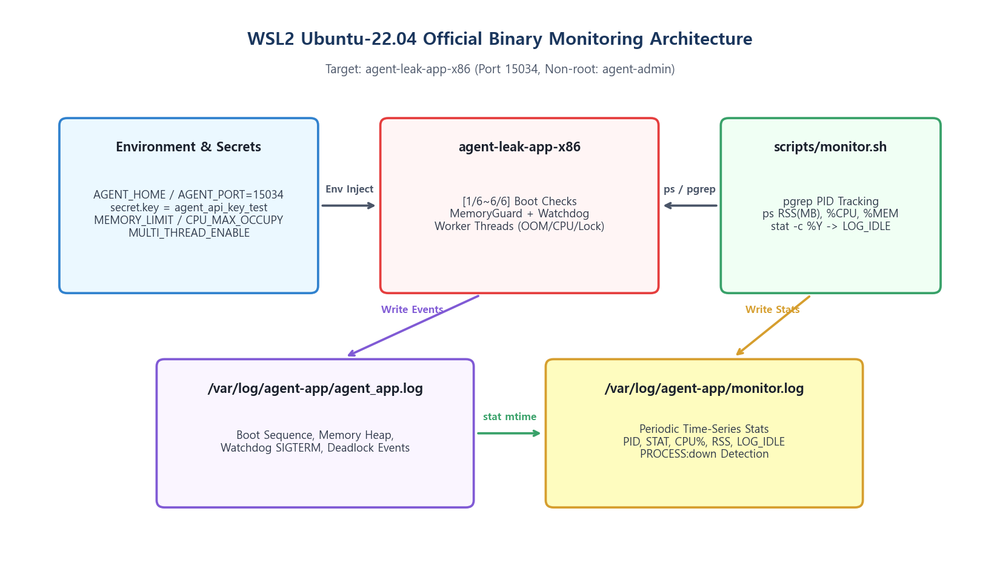

# 🚀 Codyssey B4-02 — 리눅스 시스템 장애 트러블슈팅 (공식 바이너리 실측 기반)

공식 배포 바이너리 **`agent-leak-app-x86`** 을 WSL2 `Ubuntu-22.04` 환경에서 직접 구동·관제하여 **OOM Crash**, **CPU 과점유(Watchdog)**, **Deadlock(교착 상태)** 3대 장애를 재현하고, 표준 리눅스 도구(`monitor.sh`, `ps`, `top -H`, `tail -f`)로 증거를 수집해 GitHub Issue 보고서로 정리한 프로젝트입니다.

---

## 📂 주요 산출물 안내
* **기획서 & 스터디:** [PLAN.md](PLAN.md) | [스터디.md](스터디.md) | [REPORT.md](REPORT.md)
* **GitHub Issue 리포트 3건:**
  * [issues/01_oom_crash_issue.md](issues/01_oom_crash_issue.md) — `MEMORY_LIMIT=128` (`exit 137`) ➔ `512` 정상 유지
  * [issues/02_cpu_latency_issue.md](issues/02_cpu_latency_issue.md) — `CPU_MAX_OCCUPY=80` (`exit 143`) ➔ `30` Cooldown 정상 유지
  * [issues/03_deadlock_issue.md](issues/03_deadlock_issue.md) — `MULTI_THREAD_ENABLE=true` (`BLOCKED`) ➔ `false` 순차 완료
* **관제/실험 스크립트 & 테스트:** `scripts/setup_environment.sh`, `scripts/monitor.sh`, `scripts/run_experiments.sh`, `scripts/log_analyzer.py`, `tests/test_log_analyzer.py`
* **NotebookLM 학습 자료:** [NOTEBOOKLM_GUIDE.md](NOTEBOOKLM_GUIDE.md) | [NOTEBOOKLM_FULL_SOURCE.txt](NOTEBOOKLM_FULL_SOURCE.txt)

---

## 📊 시스템 아키텍처


---

## 🧪 평가자 원클릭 검증 (Windows / Linux 공통)

아래 명령어를 실행하면 모든 필수 문서, 다이어그램, 실측 로그, JSON 결과, 단위 테스트(Mock) 통과 여부를 1초 만에 검증합니다.
```bash
python scripts/verify_requirements.py
```

---

## 🎬 평가자 앞 라이브 시연 가이드 (WSL2 공식 바이너리 직접 실행)

Windows PowerShell에서 WSL2 리눅스 일반 사용자(`agent-admin`)로 접속한 뒤 순서대로 실행합니다.

### 0단계: WSL2 접속 및 필수 환경변수 설정
```bash
wsl -u agent-admin
cd /home/agent-admin/agent-app
export AGENT_HOME=/home/agent-admin/agent-app
export AGENT_PORT=15034
export AGENT_UPLOAD_DIR=$AGENT_HOME/upload_files
export AGENT_KEY_PATH=$AGENT_HOME/api_keys
export AGENT_LOG_DIR=/var/log/agent-app
```

### 1단계: OOM 시연 (`MEMORY_LIMIT` 128MB ➔ 512MB)
```bash
# [Before] 128MB 제한으로 실행 -> 약 18초 후 MemoryGuard 자폭(exit 137)
pkill -9 -f agent-leak-app || true
export MEMORY_LIMIT=128 CPU_MAX_OCCUPY=30 MULTI_THREAD_ENABLE=false
./agent-leak-app-x86 &
tail -f $AGENT_LOG_DIR/agent_app.log

# [After] 512MB로 상향 -> 크래시 없이 정상 동작
pkill -9 -f agent-leak-app || true
export MEMORY_LIMIT=512
./agent-leak-app-x86 &
tail -f $AGENT_LOG_DIR/agent_app.log
```

### 2단계: CPU 과점유 시연 (`CPU_MAX_OCCUPY` 80% ➔ 30%)
```bash
# [Before] 80% 설정 -> 50% 초과 시 Watchdog SIGTERM 종료(exit 143)
pkill -9 -f agent-leak-app || true
export MEMORY_LIMIT=512 CPU_MAX_OCCUPY=80 MULTI_THREAD_ENABLE=false
./agent-leak-app-x86 &
tail -f $AGENT_LOG_DIR/agent_app.log

# [After] 권고치 30%로 하향 -> Cooldown 모드로 무중단 순환
pkill -9 -f agent-leak-app || true
export CPU_MAX_OCCUPY=30
./agent-leak-app-x86 &
tail -f $AGENT_LOG_DIR/agent_app.log
```

### 3단계: Deadlock 시연 (`MULTI_THREAD_ENABLE` true ➔ false)
```bash
# [Before] true -> PID는 살아있지만(ps) CPU 0%(top) + BLOCKED 멈춤(tail)
pkill -9 -f agent-leak-app || true
export MEMORY_LIMIT=512 CPU_MAX_OCCUPY=30 MULTI_THREAD_ENABLE=true
./agent-leak-app-x86 &
sleep 8
ps -ef | grep agent-leak-app-x86
top -b -n 1 -H -p $(pgrep -n -f agent-leak-app-x86)
tail -n 10 $AGENT_LOG_DIR/agent_app.log

# [After] false -> 순차 처리로 정상 완료
pkill -9 -f agent-leak-app || true
export MULTI_THREAD_ENABLE=false
./agent-leak-app-x86 &
tail -f $AGENT_LOG_DIR/agent_app.log
```

