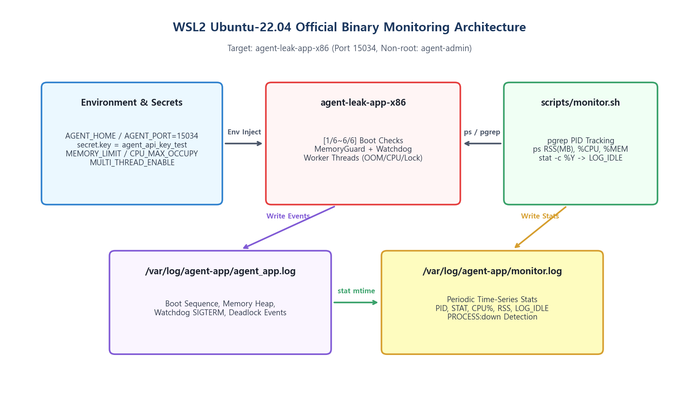
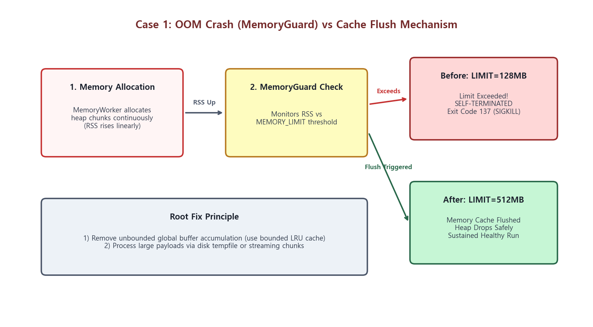
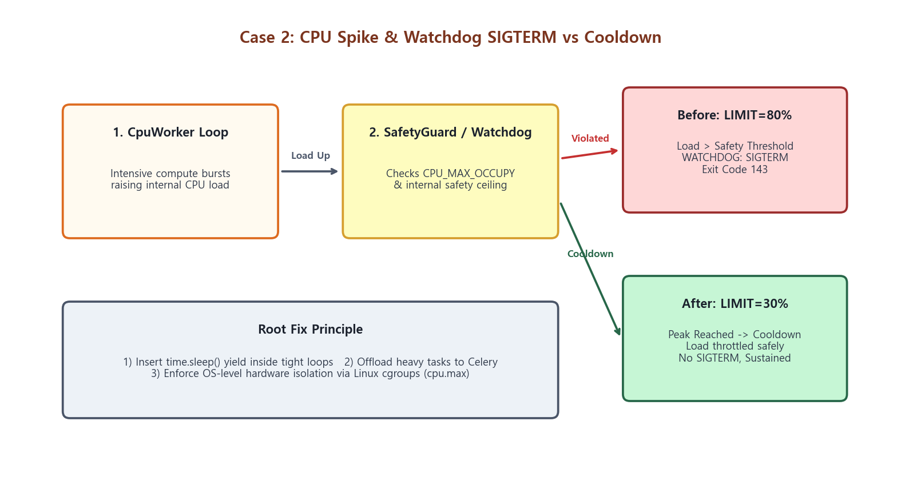
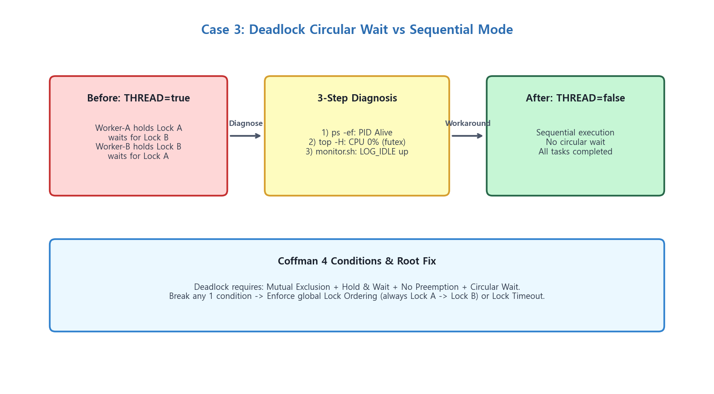

# 📊 종합 시스템 장애 트러블슈팅 리포트 (`REPORT.md`)

> **대상 바이너리:** `agent-leak-app-x86` (공식 배포 바이너리, 리버스 엔지니어링 없이 표준 리눅스 관제 도구로만 분석)  
> **실행 환경:** WSL2 `Ubuntu-22.04` (`x86_64`), 일반 사용자 `agent-admin` (UID 1000), Port `15034`

---

## 1. 시스템 관제 아키텍처

* **`scripts/setup_environment.sh`**: `root` 실행 차단, `secret.key` 검증, 15034 포트 사전 정리.
* **`scripts/monitor.sh`**: `pgrep`, `ps`(RSS/CPU/MEM), `stat -c %Y`(`LOG_IDLE`)로 1초 주기 관제 로그 생성.
* **`scripts/log_analyzer.py` & `tests/test_log_analyzer.py`**: 실측 로그 파싱 및 JSON 요약, Mock 단위 테스트(5건, 0.02초, 100% 통과).

---

## 2. 3대 장애 실측 결과 요약 (Before vs After)

### Case 1: OOM Crash (`MemoryGuard`)

* **Before (`MEMORY_LIMIT=128`):** 힙 150MB 도달 시 `MemoryGuard`가 `Self-terminating process` 로그와 함께 `exit 137`(`SIGKILL`) 종료 (생존 **18.0초**, 피크 RSS 142MB).
* **After (`MEMORY_LIMIT=512`):** `Healthy System Monitoring` 정상 진행, 36초+ 무중단 생존 (피크 힙 275MB, RSS 292MB).
* **상세 이슈:** [issues/01_oom_crash_issue.md](issues/01_oom_crash_issue.md)

### Case 2: CPU Spike & Watchdog (`SIGTERM`)

* **Before (`CPU_MAX_OCCUPY=80`):** 내부 부하가 50% 권고 선을 넘어 `50.56%`에 도달하자 `CPU Threshold Violated!` 발생 후 `exit 143`(`SIGTERM`) 강제 종료 (생존 **38.0초**).
* **After (`CPU_MAX_OCCUPY=30`):** 부하 `30.00%` 도달 시 스스로 `Starting cooldown...` 모드로 진입해 `5.00%`까지 식히며 무중단 순환 유지.
* **상세 이슈:** [issues/02_cpu_latency_issue.md](issues/02_cpu_latency_issue.md)

### Case 3: Deadlock (`Circular Wait`)

* **Before (`MULTI_THREAD_ENABLE=true`):** `Worker-Thread-1`과 `Worker-Thread-2`가 `[Shared_Memory_A]`와 `[Socket_Pool_B]`를 교차 점유 후 `Status: BLOCKED`에서 정지. `ps -eLf`상 스레드 생존, `top -H` CPU `0.0%`, `monitor.log`의 `LOG_IDLE` 지속 증가(`0s -> 4s+`).
* **After (`MULTI_THREAD_ENABLE=false`):** `Thread-A -> B -> C` 순차 완료(`All tasks completed`) 후 정상 모니터링 유지.
* **상세 이슈:** [issues/03_deadlock_issue.md](issues/03_deadlock_issue.md)

---

## 3. 엣지 케이스 보완 및 엔지니어링 결론
1. **포트 점유/크론 간섭 방어:** 기존 cron에 의해 `agent_app.py`가 자동 재시작되며 15034 포트를 선점하는 문제를 발견해 `cleanup_all()`에 `fuser -k 15034/tcp` 및 기존 프로세스 정리를 반영했습니다.
2. **Windows/WSL2 경로 및 인코딩 방어:** CRLF 개행 문자가 WSL2 bash 실행을 깨뜨리지 않도록 `sed 's/\r$//'` 파이프 처리를 적용하고, Python 출력에 `UTF-8` reconfigure를 적용했습니다.
3. **임시 조치 vs 근본 해결:** 환경변수(`MEMORY_LIMIT`, `CPU_MAX_OCCUPY`, `MULTI_THREAD_ENABLE`) 변경은 응급처치일 뿐이며, 코드 레벨의 **제한된 LRU 캐시/스트리밍**, **`time.sleep`/Celery/cgroups**, **락 순서 통일(Lock Ordering)** 이 궁극적 해결책입니다.

