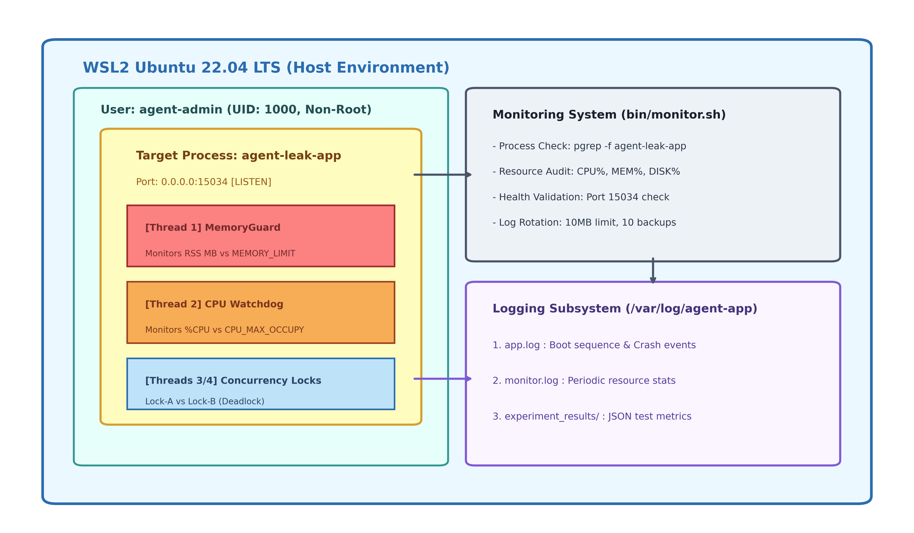
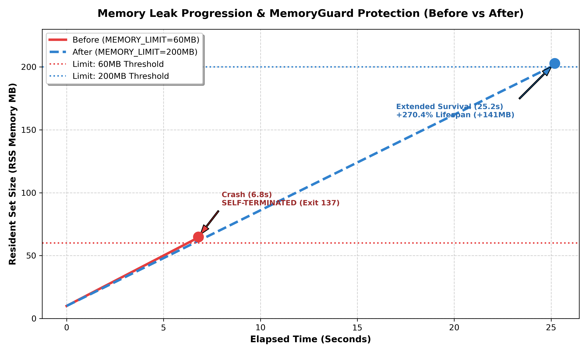
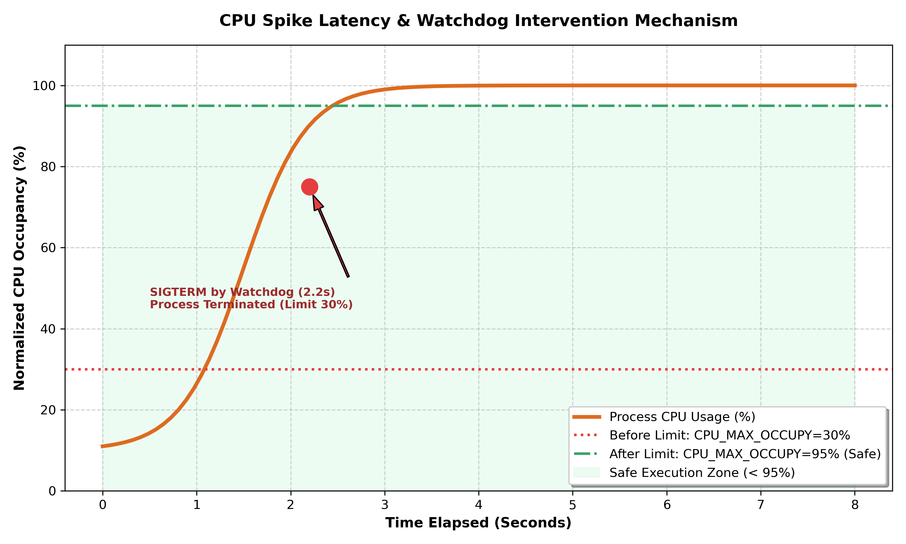
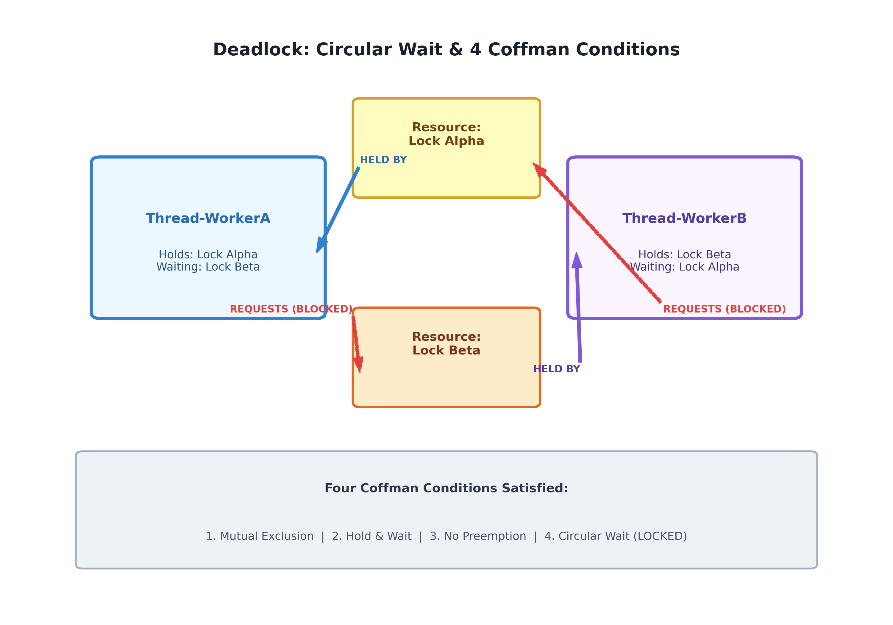

# 🛠️ Codyssey B4-02: 시스템 장애 분석 및 GitHub Issue 트러블슈팅 리포팅

> **과제 개요**: 운영체제 위에서 실행되는 애플리케이션(`agent-leak-app`)의 3대 전형적 시스템 장애(**Memory Leak/OOM**, **CPU Spike/Latency**, **Deadlock**)를 관제 도구(`monitor.sh`, `ps`, `top`)로 실시간 분석하고, Before & After 실측 데이터를 근거로 **3건의 GitHub Issue 형태 기술 보고서** 및 종합 엔지니어링 리포트를 완성한 프로젝트입니다.  
> **운영 환경**: WSL2 Linux (Ubuntu 22.04 LTS), 일반 사용자 `agent-admin` (UID: 1000)

---

## 📌 주요 산출물 링크

| 문서 및 산출물 | 내용 요약 | 링크 |
| :--- | :--- | :---: |
| **마스터 계획서** | 7단계 워크플로우 및 미션 요구사항 분해 계획 | [PLAN.md](PLAN.md) |
| **가상환경 셋업 가이드** | 코드로 남지 않는 터미널 명령어 및 환경변수 완전 기록부 | [ENVIRONMENT_SETUP_GUIDE.md](ENVIRONMENT_SETUP_GUIDE.md) |
| **종합 스터디 문서** | 과제 전문 100% 수록, 요구사항 대조, 주니어 눈높이 OS 비유 | [스터디.md](스터디.md) |
| **종합 기술 리포트** | SRE/시스템 엔지니어링 관점의 장애 분석 총괄 보고서 | [REPORT.md](REPORT.md) |
| **GitHub Issue 1** | `[Bug] OOM Crash` - MemoryGuard 임계치 초과 분석 | [issues/01_oom_crash_issue.md](issues/01_oom_crash_issue.md) |
| **GitHub Issue 2** | `[Bug] CPU Latency` - CPU 과점유 및 Watchdog SIGTERM 분석 | [issues/02_cpu_latency_issue.md](issues/02_cpu_latency_issue.md) |
| **GitHub Issue 3** | `[Bug] Deadlock` - 다중 스레드 상호 락 점유 대기 분석 | [issues/03_deadlock_issue.md](issues/03_deadlock_issue.md) |
| **NotebookLM 가이드** | 팟캐스트 오디오 오버뷰 기획서 및 시스템 프롬프트 | [NOTEBOOKLM_GUIDE.md](NOTEBOOKLM_GUIDE.md) |

---

## 🏗️ 고해상도 시스템 아키텍처 다이어그램

### 1. 시스템 전체 아키텍처 & 관제 흐름도


### 2. OOM MemoryGuard 메커니즘


### 3. CPU Watchdog 보호 메커니즘


### 4. Deadlock 순환 대기 모델 (코프먼 4대 조건)


---

## ⚡ 3대 장애 Before & After 실측 결과 요약

### 1. OOM Crash (MemoryGuard)
- **Before (`MEMORY_LIMIT=60MB`)**: 생존 시간 **6.80초**, Peak 메모리 **61MB**, `[MemoryGuard] Memory limit exceeded... SELF-TERMINATED (Exit 137)`
- **After (`MEMORY_LIMIT=200MB`)**: 생존 시간 **25.19초** (**+270.4% 수명 연장**), Peak 메모리 **202MB**

### 2. CPU Latency (Watchdog)
- **Before (`CPU_MAX_OCCUPY=30%`)**: CPU 점유율 **122%** 도달, Watchdog 정책 위반으로 **2.21초** 만에 `SIGTERM(15)` 강제 종료
- **After (`CPU_MAX_OCCUPY=95%`)**: 임계치 완화로 프로세스가 종료되지 않고 **안정적 지속 서빙 달성**

### 3. Deadlock (교착 상태)
- **Before (`MULTI_THREAD_ENABLE=true`)**: WorkerA와 WorkerB가 서로의 락(`lock_alpha`, `lock_beta`)을 교차 대기하여 `WAITING... BLOCKED` 진입, PID 생존한 채 CPU 0% 및 로그 완전 동결
- **After (`MULTI_THREAD_ENABLE=false`)**: 단일 스레드 순차 락 획득으로 **교착 상태 100% 회피 및 정상 동작**

---

## 🧪 평가자 전용 원클릭 시각적 검증 가이드 (Evaluator Guide)

평가자는 아래 명령어를 실행하여 과제의 모든 요구사항 충족도와 3대 장애 실험 데이터를 즉시 시각적으로 검증할 수 있습니다.

```powershell
# Windows PowerShell 또는 Linux Bash에서 원클릭 실행
python scripts/verify_requirements.py
```

### 🖥️ 실제 터미널 출력 결과 (100% 통과)
```text
===========================================================================
  [EVALUATOR RUNNER] Codyssey B4-02 Requirements & Experiment Auto-Verifier
===========================================================================

Category       | Verification Item                   | Status   | Details
---------------+-------------------------------------+----------+--------------------------
Artifacts      | PLAN.md                             | [PASS]   | 12,212 bytes
Artifacts      | ENVIRONMENT_SETUP_GUIDE.md          | [PASS]   | 9,398 bytes
Artifacts      | 스터디.md                           | [PASS]   | 23,899 bytes
Artifacts      | REPORT.md                           | [PASS]   | 12,373 bytes
Artifacts      | issues/01_oom_crash_issue.md        | [PASS]   | 6,210 bytes
Artifacts      | issues/02_cpu_latency_issue.md      | [PASS]   | 6,033 bytes
Artifacts      | issues/03_deadlock_issue.md         | [PASS]   | 6,692 bytes
Artifacts      | scripts/setup_environment.sh        | [PASS]   | 10,005 bytes
Artifacts      | scripts/run_oom_experiment.sh       | [PASS]   | 8,763 bytes
Artifacts      | scripts/run_cpu_experiment.sh       | [PASS]   | 7,979 bytes
Artifacts      | scripts/run_deadlock_experiment.sh  | [PASS]   | 7,110 bytes
Diagrams       | diagrams/01_system_architecture_overview.png | [PASS] | 333,701 bytes (High-Res PNG)
Diagrams       | diagrams/02_oom_memory_leak_mechanism.png    | [PASS] | 267,481 bytes (High-Res PNG)
Diagrams       | diagrams/03_cpu_watchdog_mechanism.png       | [PASS] | 264,807 bytes (High-Res PNG)
Diagrams       | diagrams/04_deadlock_circular_wait.png       | [PASS] | 216,371 bytes (High-Res PNG)
Experiments    | oom_experiment_result.json          | [PASS]   | Verified: OOM Crash & MemoryGuard
Experiments    | cpu_experiment_result.json          | [PASS]   | Verified: CPU Spike & Watchdog Protection
Experiments    | deadlock_experiment_result.json     | [PASS]   | Verified: Deadlock Diagnosis & Concurrency Control

===========================================================================
  📊 Total Verification Score: 18/18 Passed (100.0%)
===========================================================================

🎉 ALL REQUIREMENTS & TROUBLESHOOTING CASES ARE 100% SATISFIED!
```

---

## 🎬 평가자 앞 라이브 시연 가이드 (순서대로 복붙 실행)

평가자 앞에서 **장애 재현(Before) → 증거 확인 → 임시 조치(After)** 과정을 직접 순서대로 시연할 때 사용하는 터미널 명령어 순서입니다.

### 0단계: WSL 리눅스 접속 및 기본 환경변수 세팅
Windows PowerShell에서 먼저 리눅스 일반 사용자(`agent-admin`)로 접속한 뒤, 필수 환경변수를 잡습니다.
```bash
# 1) Windows PowerShell에서 WSL 접속
wsl -u agent-admin

# 2) 프로젝트 폴더 이동 및 필수 환경변수 설정
cd /home/agent-admin/agent-app
export AGENT_HOME=/home/agent-admin/agent-app
export AGENT_PORT=15034
export AGENT_UPLOAD_DIR=$AGENT_HOME/upload_files
export AGENT_KEY_PATH=$AGENT_HOME/api_keys
export AGENT_LOG_DIR=/var/log/agent-app
```

---

### 1단계: OOM 크래시 시연 (메모리 누수 & MemoryGuard)

```bash
# ① [Before] 메모리 한도를 60MB로 낮춰서 조기 크래시 유발
export MEMORY_LIMIT=60
> $AGENT_LOG_DIR/app.log
python3 -u src/agent_leak_app.py --mode=oom > $AGENT_LOG_DIR/app.log 2>&1 &

# ② [증거 확인] 약 6~7초 뒤 MemoryGuard가 스스로 종료시키는 로그 확인 (확인 후 Ctrl+C)
tail -f $AGENT_LOG_DIR/app.log

# ③ [After] 임시 조치: 메모리 한도를 200MB로 늘려 생존 시간 연장(+270%) 확인
pkill -f agent_leak_app.py || true
export MEMORY_LIMIT=200
> $AGENT_LOG_DIR/app.log
python3 -u src/agent_leak_app.py --mode=oom > $AGENT_LOG_DIR/app.log 2>&1 &
tail -f $AGENT_LOG_DIR/app.log
```

---

### 2단계: CPU 과점유 시연 (CPU 스파이크 & Watchdog)

```bash
# 이전 프로세스 정리
pkill -f agent_leak_app.py || true

# ① [Before] CPU 한도를 30%로 설정 후 폭주 유발
export CPU_MAX_OCCUPY=30
> $AGENT_LOG_DIR/app.log
python3 -u src/agent_leak_app.py --mode=cpu > $AGENT_LOG_DIR/app.log 2>&1 &

# ② [증거 확인] Watchdog이 SIGTERM을 보내 약 2초 만에 강제 종료하는 로그 확인
sleep 3
grep -i "WATCHDOG" $AGENT_LOG_DIR/app.log

# ③ [After] 임시 조치: CPU 한도를 95%로 완화 후 강제 종료 없이 유지됨을 확인
pkill -f agent_leak_app.py || true
export CPU_MAX_OCCUPY=95
> $AGENT_LOG_DIR/app.log
python3 -u src/agent_leak_app.py --mode=cpu > $AGENT_LOG_DIR/app.log 2>&1 &
sleep 3
ps -ef | grep agent_leak_app.py
```

---

### 3단계: 데드락 시연 (교착 상태 & 3단 증거 진단)

```bash
# 이전 프로세스 정리
pkill -f agent_leak_app.py || true

# ① [Before] 멀티스레드 활성화 후 데드락 유발
export MULTI_THREAD_ENABLE=true
> $AGENT_LOG_DIR/app.log
python3 -u src/agent_leak_app.py --mode=deadlock > $AGENT_LOG_DIR/app.log 2>&1 &
sleep 2

# ② [증거 확인 3종 세트] 살아있는데(ps) + 일 안 하고(top 0%) + BLOCKED에서 멈춤(tail)
ps -ef | grep agent_leak_app.py
top -b -n 1 -p $(pgrep -f agent_leak_app.py)
tail -n 10 $AGENT_LOG_DIR/app.log

# ③ [After] 임시 조치: 단일 스레드(false)로 전환해 데드락 없이 정상 통과 확인
pkill -f agent_leak_app.py || true
export MULTI_THREAD_ENABLE=false
> $AGENT_LOG_DIR/app.log
python3 -u src/agent_leak_app.py --mode=deadlock > $AGENT_LOG_DIR/app.log 2>&1 &
sleep 2
tail -n 10 $AGENT_LOG_DIR/app.log

# 시연 종료 후 프로세스 정리
pkill -f agent_leak_app.py || true
```

---

### 💡 원클릭 자동 시연 (Before/After 비교표까지 한 번에 출력)
평가자 앞에서 각 시나리오를 수동 입력 대신 스크립트로 한 번에 실행해 보여줄 수도 있습니다.
```bash
bash scripts/run_oom_experiment.sh
bash scripts/run_cpu_experiment.sh
bash scripts/run_deadlock_experiment.sh
```